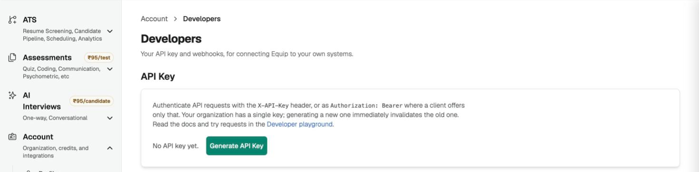

import { PlanGate } from "/snippets/plan-gate.mdx";

Every request to Equip's REST API carries your organization's **API Key**. This article covers how to create the key, how to send it, who may manage it, and how plan checks apply. For what the API offers, see [API Integrations](/api-integrations).

<PlanGate plan="Premium" noTrial />

## Generate or Rotate Your API Key

An organization **Owner or Admin** manages the key on the Developers page. Your organization has a single key, and the plaintext is shown exactly once.

<Steps>
  <Step title="Open the Developers page">
    Go to [**Account → Developers**](https://equip.co/recruiter/account/developers/). The **API Key** card shows **No API key yet** until one exists.
  </Step>
  <Step title="Generate the key">
    Click **Generate API Key** and confirm. A dialog titled **Your new API key** shows the full key, which starts with `eqp_`.
  </Step>
  <Step title="Copy it now">
    Click **Copy** and store the key in your secrets manager or password vault. Once you close the dialog, the key is never shown again; the card only shows its first characters followed by dots.
  </Step>
  <Step title="Rotate when needed">
    To replace the key, click **Rotate API Key** and confirm. The current key stops working immediately, and anything that uses it needs the new key.
  </Step>
</Steps>

{/* screenshot: the API Key card on Account → Developers before a key exists, with the Generate API Key button */}

<Frame caption="The API Key card on the Developers page">
  
</Frame>

<Note>
If you lose the key, there is no way to view it again. Rotate it to get a new one, then update every system that uses the old key.
</Note>

## Send the Key With Each Request

Put the key in the **`X-API-Key`** header. Equip also accepts **`Authorization: Bearer eqp_...`** for clients that only offer a bearer token, such as MCP clients. When both headers are present, `X-API-Key` wins and the Authorization header is ignored.

```sh
# Preferred: X-API-Key header
curl "https://equip.co/api/v3/job-openings/?limit=5" \
  -H "X-API-Key: eqp_your_api_key"

# Also accepted: bearer token
curl "https://equip.co/api/v3/job-openings/?limit=5" \
  -H "Authorization: Bearer eqp_your_api_key"
```

All endpoints live under `https://equip.co/api/v3/`. The full list, with request and response schemas, is in the [Developer Playground](/developer-playground) and in the OpenAPI document at `https://equip.co/api/v3/openapi.json`.

<Tip>
Keep the key out of your code. Read it from an environment variable or a secrets manager, and never commit it to a repository.
</Tip>

## One Key per Organization

The API key belongs to the **organization**, not to the person who generated it. There is exactly one active key at a time, and it is shared by every integration your organization runs.

| Action | Who can do it | Effect |
|---|---|---|
| **Generate API Key** | Organization Owner or Admin | Creates the organization's first key |
| **Rotate API Key** | Organization Owner or Admin | Issues a new key; the old one stops working immediately |
| View the full key again | No one | The plaintext is shown only once, at generation |

Recruiters who are not Owners or Admins see a notice on the Developers page telling them who to ask. Rotation is the only way to revoke a key, so treat it as your response to any suspected leak.

<Warning>
The key acts as your organization's **admin**. Anyone who holds it can read everything an admin can see across every job opening, invite candidates (which spends your credits), and create or update openings, assessments and interviews. Share it only with systems and people who may do all of that, and rotate it immediately if it leaks.
</Warning>

## What the Key Can and Cannot Do

A key may do what a recruiter may do in the dashboard, with a few areas locked down because a leaked key must not be able to re-key itself or spend money.

| Area | Access with an API key | Error if you try |
|---|---|---|
| Job openings, job posts, applications, assessments, AI interviews, test attempts, live interviews, templates, interview panels | Read and write as documented | |
| Organization settings, users, credits ledger | Read only | `API key authentication is read-only for this endpoint` |
| Integration connections, departments, hiring team members | Not reachable | `API key authentication is not allowed for this endpoint` |

Both refusals come back as a **403** with the message above in the `message` field. See [API Rate Limits and Errors](/api-rate-limits-and-errors) for the other error shapes.

## Plan Checks on Every Request

API keys and webhooks are the **API & Webhooks** feature. Until your plan includes it, the Developers page shows an upgrade prompt instead of the key card; see [Compare Plans](/compare-plans).

<Note>
Equip checks your plan on every API request, not only when the key is created. If your organization's plan stops including the feature or its subscription lapses, requests return a **403** with `error_code` `FEATURE_NOT_IN_PLAN` until the plan is restored. The [MCP server](/connect-ai-assistant) uses the same key but is gated separately.
</Note>

## Related Resources

- [API Integrations](/api-integrations) - What the REST API lets you read and write
- [Developer Playground](/developer-playground) - Browse every endpoint and run read requests from your browser
- [API Rate Limits and Errors](/api-rate-limits-and-errors) - Limits per plan, response headers and every error body
- [Connect Your AI Assistant to Equip](/connect-ai-assistant) - The MCP server that uses the same key as a bearer token
