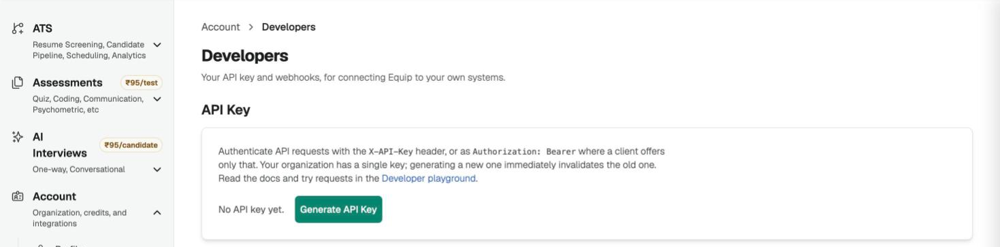
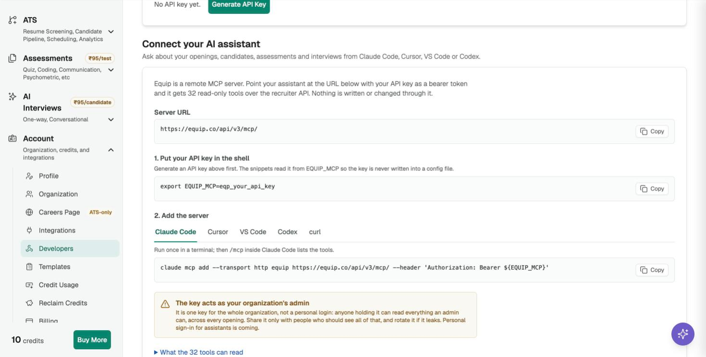

import { PlanGate } from "/snippets/plan-gate.mdx";

Equip has a remote **MCP server** at `https://equip.co/api/v3/mcp/`. Connect your AI coding assistant to it and ask questions in plain language, such as "which of my job openings have the most candidates waiting in screening?". The server is **read-only**: your assistant can look things up, and nothing is ever written or changed.

<PlanGate plan="Premium" annual />

If your plan does not include it, [contact support](/contact-support) and we can switch it on for your organization. Until then the Developers page shows an upgrade prompt in place of **Connect your AI assistant**.

## Get Your Organization's API Key

Every request to the MCP server carries your organization's **API Key**. An organization **Owner or Admin** generates it.

<Steps>
  <Step title="Open the Developers page">
    Go to [**Account → Developers**](https://equip.co/recruiter/account/developers/).
  </Step>
  <Step title="Generate the key">
    Click **Generate API Key** and copy the key (`eqp_...`). It is shown only once; if you lose it, click **Rotate API Key** to get a new one.
  </Step>
  <Step title="Put the key in your shell">
    Add this line to your shell profile (`~/.zshrc` or `~/.bashrc`) so it survives new terminals:

    ```sh
    export EQUIP_MCP=eqp_your_api_key
    ```

    The variable is named `EQUIP_MCP` on purpose. Claude Code blanks any variable whose name contains KEY, TOKEN or SECRET when it fills in a remote server's headers, so a name like `EQUIP_API_KEY` would silently fail.
  </Step>
</Steps>

{/* screenshot: the API Key card on Account → Developers with the Generate and Rotate buttons */}

<Frame caption="The API Key card on the Developers page">
  
</Frame>

<Warning>
The key is one key for the whole organization, not a personal login, and it acts as the organization's admin: an assistant holding it can read everything an admin can, across every opening. Share it only with people who may see all of that, and rotate it if it leaks.
</Warning>

## Pick Your Client

Each client has its own setup page with a copy-ready snippet and a check that the connection works.

<CardGroup cols={3}>
  <Card title="Claude Code" icon="terminal" href="/mcp-claude-code">
    One `claude mcp add` command.
  </Card>
  <Card title="Codex" icon="terminal" href="/mcp-codex">
    Three lines in `~/.codex/config.toml`.
  </Card>
  <Card title="Gemini CLI" icon="terminal" href="/mcp-gemini-cli">
    One entry in `~/.gemini/settings.json`.
  </Card>
</CardGroup>

The same snippets, and the full list of tools, are on [**Account → Developers**](https://equip.co/recruiter/account/developers/) under **Connect your AI assistant**.

{/* screenshot: the Connect your AI assistant section on Account → Developers with the Claude Code tab selected */}

<Frame caption="Connect your AI assistant on the Developers page, one tab per client">
  
</Frame>

### Cursor and VS Code

Both read the key from your environment or prompt you for it, so the key is never written into a config file.

<AccordionGroup>
  <Accordion title="Cursor">
    Add this to `.cursor/mcp.json` in your project, or use the **Add to Cursor** link on the Developers page.

    ```json
    {
      "mcpServers": {
        "equip": {
          "url": "https://equip.co/api/v3/mcp/",
          "headers": {
            "Authorization": "Bearer ${env:EQUIP_MCP}"
          }
        }
      }
    }
    ```
  </Accordion>
  <Accordion title="VS Code">
    Add this to `.vscode/mcp.json`. VS Code asks for the key the first time the server starts and stores it securely.

    ```json
    {
      "inputs": [
        {
          "type": "promptString",
          "id": "equip-api-key",
          "description": "Equip API key (eqp_...)",
          "password": true
        }
      ],
      "servers": {
        "equip": {
          "type": "http",
          "url": "https://equip.co/api/v3/mcp/",
          "headers": {
            "Authorization": "Bearer ${input:equip-api-key}"
          }
        }
      }
    }
    ```
  </Accordion>
</AccordionGroup>

## What Your Assistant Can Read

The tools mirror what a recruiter sees in Equip, grouped by area.

| Group | Example tools |
|---|---|
| **Job openings** | `list_job_openings`, `get_job_post_stage_counts` |
| **Candidates and applications** | `find_candidate`, `list_job_applications` |
| **Assessments and results** | `list_assessment_results`, `get_assessment_scores_for_applications` |
| **Interviews** | `list_ai_interviews`, `list_live_interviews` |
| **Organization** | `list_organization_members`, `get_ats_insight` |

The full list is on [**Account → Developers**](https://equip.co/recruiter/account/developers/) under **Connect your AI assistant**. A few tools appear only when your plan includes the matching feature, such as ATS Insights.

## Any Other MCP Client

Any client that speaks **Streamable HTTP** can connect. It sends JSON-RPC 2.0 requests as `POST` to `https://equip.co/api/v3/mcp/` with the key in an `Authorization: Bearer eqp_...` header (an `X-API-Key: eqp_...` header also works). There is no SSE stream and no session: a `GET` or `DELETE` to the URL is refused.

Check the connection from a terminal:

```sh
curl -X POST https://equip.co/api/v3/mcp/ \
  -H "Authorization: Bearer $EQUIP_MCP" \
  -H 'Content-Type: application/json' \
  -d '{"jsonrpc":"2.0","id":1,"method":"tools/list"}'
```

<Accordion title="Troubleshooting">
- **401 Invalid API key**: the key was mistyped or rotated, or `EQUIP_MCP` is not exported in this shell. Run `echo $EQUIP_MCP` to check.
- **403 "isn't included in your plan"**: your plan does not include the MCP server. See [Compare Plans](/compare-plans), or [contact support](/contact-support) to have it switched on for your organization.
- **No tools, or an empty list**: restart the client after adding the server.
</Accordion>

## Related Resources

- [Claude Code](/mcp-claude-code) - Add Equip to Claude Code with one command
- [Codex](/mcp-codex) - Add Equip to Codex's config.toml
- [Gemini CLI](/mcp-gemini-cli) - Add Equip to Gemini CLI's settings.json
- [API Integrations](/api-integrations) - The REST API behind the same key, for inviting candidates and pulling results
