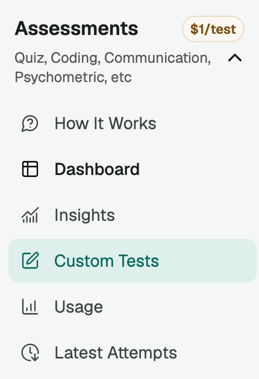
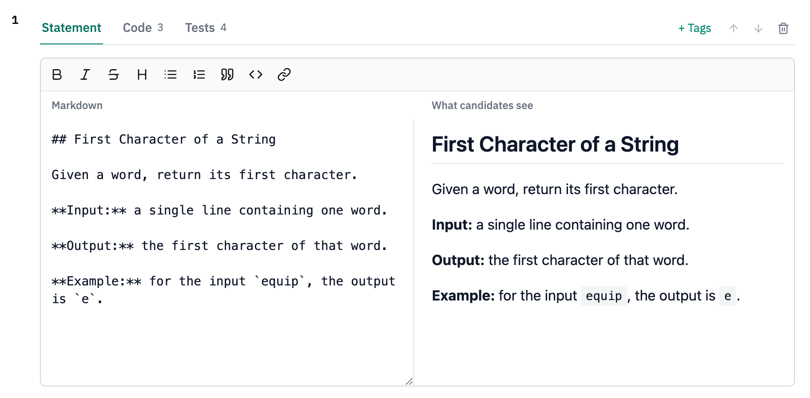
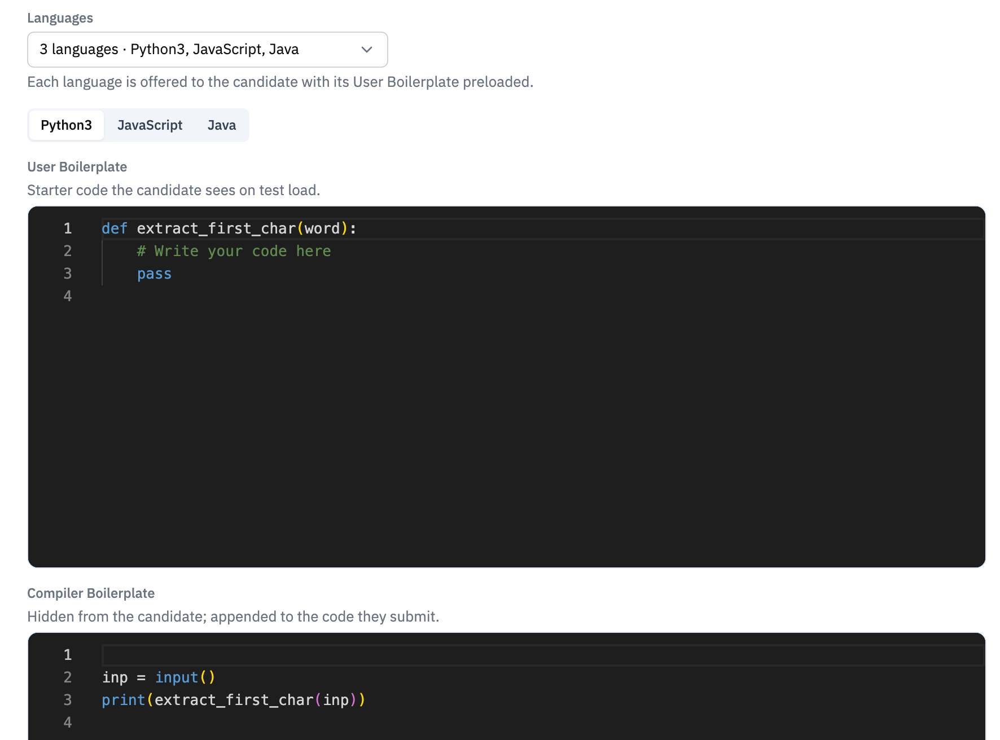
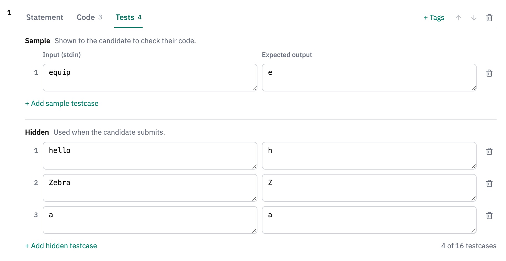
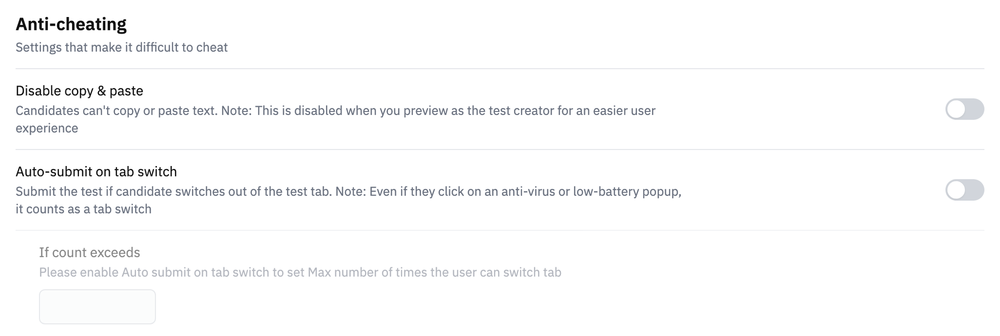
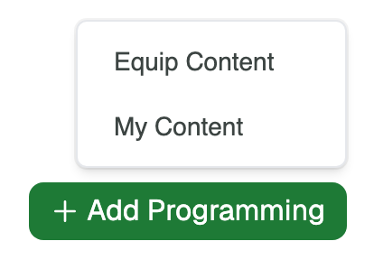

When Equip's library does not have the problem you want candidates to solve, use **Custom Tests** to create your own **Programming Test** with your problem statement, languages, boilerplates and test cases.

<Note>
Equip recommends its own coding content for most teams. Each library question has been attempted by thousands of candidates, so it is proven to work. Build a custom challenge only when you need a problem the library does not cover, because a small setup mistake can mark every submission incorrect. See [Equip Content vs Custom Content](/equip-vs-custom-content).
</Note>

## Creating the Test

<Steps>
  <Step title="Open Custom Tests">
    Open [**Custom Tests**](https://equip.co/recruiter/assessments/cms/home/) from the sidebar of your [Assessments Dashboard](https://equip.co/recruiter/assessments/dashboard/).
    {/* screenshot: Custom Tests section in the recruiter sidebar */}

    <Frame caption="Custom Tests in the Assessments section of the sidebar">
      
    </Frame>
  </Step>
  <Step title="Create a new programming test">
    Click the **Programming** tab, then **New programming test**.
  </Step>
  <Step title="Fill in the three tabs">
    Write the problem on the **Statement** tab, pick languages and write boilerplates on the **Code** tab, and add test cases on the **Tests** tab. Each tab is described below.
  </Step>
  <Step title="Set the title, duration and anti-cheating options">
    Open the test's **Settings** and fill in the fields described in [Settings](#settings), then click **Save**.
  </Step>
</Steps>

## The Editor at a Glance

| Tab | Field | What it does |
|---|---|---|
| **Statement** | Markdown | The problem statement, with a **What candidates see** preview beside it |
| **Statement** | Tags | Optional labels for organizing your questions |
| **Code** | Languages | The languages candidates can choose from |
| **Code** | User Boilerplate | Starter code the candidate sees when the test loads, one per language |
| **Code** | Compiler Boilerplate | Hidden code appended to what the candidate submits, one per language |
| **Tests** | Sample | Test cases shown to the candidate to check their code |
| **Tests** | Hidden | Test cases used to grade the submission |

## Statement

Write the problem in **Markdown** on the left; the right side shows exactly what candidates will see. State what the program should do, the **input format**, the **output format**, and an example.

{/* screenshot: problem statement editor for a custom programming test */}

<Frame caption="The problem statement, in Markdown with a live preview">
  
</Frame>

<Tip>
Spell out the input and output formats even when they seem obvious. Candidates used to another platform get stuck when the format is left to guesswork.
</Tip>

## Code

A candidate never sees a blank file. They see your **boilerplate**: starter code with a single function left for them to fill in, while your code around it reads their input and prints their output.

Each enabled language has two boilerplate fields:

| Field | Candidate sees it? | What goes in it |
|---|---|---|
| **User Boilerplate** | Yes, preloaded when the test opens | The function signature the candidate completes |
| **Compiler Boilerplate** | No, it is appended to their submission | Code that reads the input, calls their function and prints the result |

{/* screenshot: Code tab with the Python3 User Boilerplate and Compiler Boilerplate */}

<Frame caption="The candidate's function and the hidden input and output code">
  
</Frame>

<Warning>
Test cases run against the *whole* program, not just the candidate's function. If the Compiler Boilerplate of any enabled language has a bug, every submission in that language fails, even correct ones.
</Warning>

See [Supported Programming Languages](/programming-languages) for the languages and versions available. If you need a language that is not listed, contact us on live chat or email hello@equip.co, and we can enable it for your account.

## Tests

Programming tests are **auto-evaluated**: Equip runs each submission against your test cases and grades it automatically. Each test case is an **Input (stdin)** and an **Expected output**.

| Test case type | Purpose |
|---|---|
| **Sample** | Shown to the candidate, so they can check their code before submitting |
| **Hidden** | Used to grade the submission when the candidate submits |

{/* screenshot: Tests tab with the sample and hidden test cases for this problem */}

<Frame caption="One sample and three hidden test cases">
  
</Frame>

<Note>
A programming test allows up to **16 test cases** in total, sample and hidden combined.
</Note>

<Warning>
Be exact with input and output formats. A stray space or a missing newline in an expected output can mark every submission incorrect. Include boundary values too, or incorrect solutions can still score full marks.
</Warning>

## Settings

Open the test's **Settings** tab to set the rest.

| Section | Field | What it does |
|---|---|---|
| **General** | Title | The test's name, shown to you and to candidates |
| **General** | Duration (in mins) | The time limit for the test |
| **Questions & points** | Points | What the question is worth |
| **Anti-cheating** | Disable copy & paste | Candidates cannot copy or paste text |
| **Anti-cheating** | Auto-submit on tab switch | Submits the test when the candidate leaves the test tab |
| **Anti-cheating** | If count exceeds | How many tab switches are allowed before auto-submit; available once Auto-submit on tab switch is on |

{/* screenshot: Anti-cheating settings of a custom programming test */}

<Frame caption="Anti-cheating settings of a programming test">
  
</Frame>

<Note>
Copy and paste stays enabled when you preview the test yourself, for an easier review. Any switch away from the tab counts, even clicking an antivirus or low-battery popup.
</Note>

## Example 1: Single-Line Input

**Problem statement:** Given a string, return its first character. For the input `equip`, the output is `e`.

The test case is that pair: input `equip`, expected output `e`. The boilerplate reads one line, calls the candidate's function and prints the result:

<CodeGroup>

```python Python
# User Boilerplate: the candidate writes this
def extract_first_char(word):
    # candidate's logic here
    pass

# Compiler Boilerplate: reads input, prints output
inp = input()
print(extract_first_char(inp))
```

```javascript JavaScript
// User Boilerplate: the candidate writes this
function extractFirstChar(word) {
  // candidate's logic here
}

// Compiler Boilerplate: reads input, prints output
const readline = require('readline').createInterface({ input: process.stdin });
readline.on('line', (word) => {
  console.log(extractFirstChar(word));
  readline.close();
});
```

```java Java
import java.util.Scanner;

// User Boilerplate: the candidate writes this
class Solution {
    public char firstChar(String input) {
        // candidate's logic here
        return ' ';
    }
}

// Compiler Boilerplate: reads input, prints output
class Driver {
    public static void main(String[] args) {
        Scanner sc = new Scanner(System.in);
        String word = sc.next();
        System.out.print(new Solution().firstChar(word));
    }
}
```

</CodeGroup>

## Example 2: Multi-Line Input

**Problem statement:** Given an array and an index, return the value at that index. The input arrives as three lines:

```
4
5 6 3 2
2
```

The first line is the array's length, the second is the array, and the third is the index. For this input, the expected output is `3`. The Compiler Boilerplate now reads three lines and builds structured data before calling the candidate's function:

<CodeGroup>

```python Python
# User Boilerplate: the candidate writes this
def get_value_at_index(index, arr):
    # candidate's logic here
    pass

# Compiler Boilerplate: reads 3 lines, builds structured data, prints output
length = int(input())
arr = list(map(int, input().split()))
index = int(input())
print(get_value_at_index(index, arr))
```

```javascript JavaScript
// User Boilerplate: the candidate writes this
function getValueAtIndex(index, arr) {
  // candidate's logic here
}

// Compiler Boilerplate: reads 3 lines, builds structured data, prints output
const lines = [];
const readline = require('readline').createInterface({ input: process.stdin });
readline.on('line', (line) => {
  lines.push(line);
  if (lines.length === 3) {
    const arr = lines[1].split(' ').map(Number);
    const index = Number(lines[2]);
    console.log(getValueAtIndex(index, arr));
    readline.close();
  }
});
```

</CodeGroup>

<Tip>
Do the parsing in the Compiler Boilerplate, so the candidate's function gets clean, typed values and candidates are tested on the problem, not on input formatting.
</Tip>

## Checking the Test Before Inviting Candidates

An input or output bug does not fail loudly. It marks every submission wrong, and you may only find out after candidates have finished. Confirm that a correct solution passes every test case in every enabled language first.

<Steps>
  <Step title="Review the problem statement">
    Check that the input format, output format and any constraints are stated explicitly.
  </Step>
  <Step title="Check the boilerplate for every language">
    Verify both boilerplates for each enabled language, not just the one you wrote the question in.
  </Step>
  <Step title="Verify the test cases">
    Work through them by hand. Confirm each expected output matches exactly, including spacing and line breaks.
  </Step>
  <Step title="Solve it in Preview">
    Add the test to an assessment and open it in [Preview](/preview-assessment). Submit a known-correct solution in each enabled language and confirm every test case passes. Previews are free and unlimited for your whole team.
  </Step>
</Steps>

<Note>
If you [randomize coding questions](/randomize-coding-questions), check every question in the pool the same way.
</Note>

## Adding the Test to an Assessment

A custom test cannot be shared with candidates directly. It must sit inside an assessment.

<Steps>
  <Step title="Open the assessment's Tests tab">
    Open the settings of a new or existing assessment and select the **Tests** tab. Click **Programming** in the left sidebar.
  </Step>
  <Step title="Add your test">
    Click the **Add Programming** button and select **My Content**, then pick your custom programming test.
    {/* screenshot: Add Programming button with My Content option */}

    <Frame caption="Add Programming, then My Content">
      
    </Frame>
  </Step>
</Steps>

<Tip>
Each programming test holds one question. To give different candidates different problems, create several custom tests and use the randomize option in the assessment. See [Randomizing Programming and SQL Questions](/randomize-coding-questions).
</Tip>

## Getting Help

Equip's support team **cannot triage custom coding questions**. When one misbehaves, the cause is almost always in its setup, and the checks above resolve the vast majority of issues.

<Note>
If the skill you want to test would be useful to other companies too, Equip can create the test for you, usually free of charge. Reach out on live chat or email hello@equip.co; most skills take around 5 business days. See [Can't Find a Role or Skill?](/cant-find-role-or-skill).
</Note>

## Related Resources

- [Supported Programming Languages](/programming-languages) - Languages and versions available for coding tests
- [Randomizing Programming and SQL Questions](/randomize-coding-questions) - Serve a random challenge from a pool to each candidate
- [Creating a Custom SQL Test](/custom-sql-test) - The same flow for SQL problems
- [Previewing an Assessment](/preview-assessment) - Solve your own challenge for free before inviting candidates
