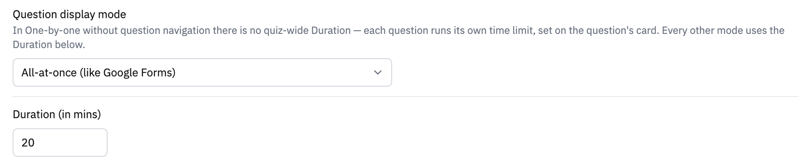
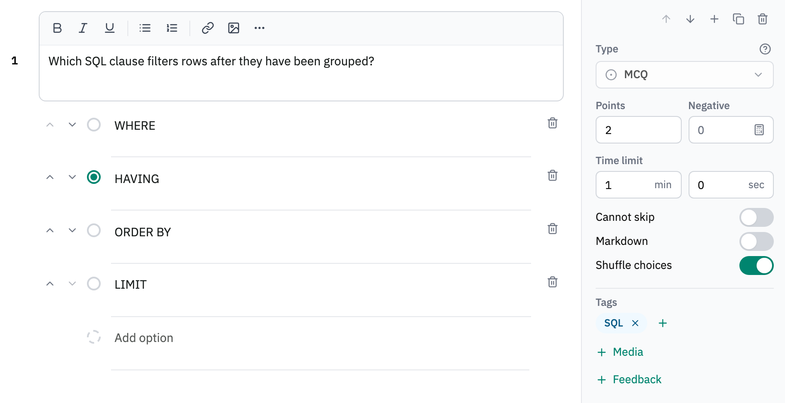

## Where to Set Time Limits

You set time limits while creating or editing a **Custom Quiz**. Timers live inside the quiz itself, not in the assessment settings. Where the timer goes depends on the quiz's **Question display mode**:

| Display mode | Where the time limit goes |
|---|---|
| **All-at-once** | One **Duration** for the whole quiz |
| **One-by-one, with question navigation** | One **Duration** for the whole quiz |
| **One-by-one, without question navigation** | A **Time limit** on each question's card |

<Steps>
  <Step title="Open your Custom Quiz">
    From the [Assessments Dashboard](https://equip.co/recruiter/assessments/dashboard/), open [**Custom Tests**](https://equip.co/recruiter/assessments/cms/home/) and select the quiz you want to edit.
  </Step>
  <Step title="Check the display mode">
    Open the quiz's **Settings**. Under **General**, **Question display mode** decides which timer applies.
  </Step>
  <Step title="Set the timer and save">
    For the two modes with a quiz-wide timer, enter the **Duration (in mins)** below the display mode. For one-by-one without navigation, set the **Time limit** in minutes and seconds on each question's card instead. Then click **Save**.
  </Step>
</Steps>

{/* screenshot: Question display mode and Duration fields in the quiz's General settings */}

<Frame caption="One Duration for the whole quiz">
  
</Frame>

{/* screenshot: question card with its Time limit field in a one-by-one quiz without navigation */}

<Frame caption="A time limit on each question, in one-by-one mode without navigation">
  
</Frame>

Here is a short video walkthrough of setting the timer for a custom quiz:

<iframe
  width="560"
  height="315"
  src="https://www.youtube.com/embed/yfLIakvmiNA?rel=0"
  title="Setting Timer for Custom Quiz"
  frameBorder="0"
  allowFullScreen
  style={{width: "100%", maxWidth: "560px", borderRadius: "0.75rem"}}
></iframe>

<Note>
If you are using **Equip Content**, every question already has a fixed timer that cannot be changed. See [Time Limits on Equip](/time-limits) for how those timers work.
</Note>

<Tip>
Importing questions from Excel? The template's **Time** column accepts a value in seconds for each question, so you can set per-question timers in bulk. See [Import Questions from Excel](/import-questions-from-excel).
</Tip>

## Quiz-Wide Duration

In **all-at-once** and **one-by-one with navigation** quizzes, one countdown runs for the whole quiz and candidates choose how to spend it across questions. To control how long candidates spend on each question, switch the quiz to one-by-one without navigation instead.

<Note>
There is no time limit for an **entire assessment**, only for the tests and questions inside it. If a custom test has questions without timers, the Estimated Assessment Duration can be inaccurate. See [Assessment Duration](/assessment-duration) for details.
</Note>

## Switching Between Display Modes

You can change a quiz's display mode at any time, and the timer model switches with it.

<Warning>
Changes take effect as soon as you save. Candidates who start the quiz after you save see the new question flow and timers, so avoid switching modes in the middle of an active hiring drive.
</Warning>

For what candidates see in each mode, see [Quiz Display Modes](/quiz-display-modes).

## Related Resources

- [Quiz Display Modes](/quiz-display-modes) - What candidates see in each of the three modes
- [Time Limits on Equip](/time-limits) - Which test types support timers and at what level
- [Assessment Duration](/assessment-duration) - Why assessments have no overall time limit
- [Import Questions from Excel](/import-questions-from-excel) - Set question timers in bulk via the import template
