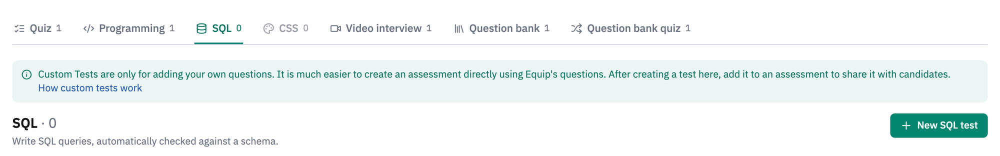

A **custom SQL test** lets you define your own tables and ask candidates to write a query against them. Equip runs the candidate's query against your data and grades it automatically.

To start one, open [**Custom Tests**](https://equip.co/recruiter/assessments/cms/home/), select the **SQL** tab and click **New SQL test**.

{/* screenshot: SQL tab of Custom Tests with the New SQL test button */}

<Frame caption="The SQL tab of Custom Tests">
  
</Frame>

Here is a walkthrough of creating one:

<iframe
  width="560"
  height="315"
  src="https://www.youtube.com/embed/Q-iqwKYCsg0?rel=0"
  title="Creating a Custom SQL Test"
  frameBorder="0"
  allowFullScreen
  style={{width: "100%", maxWidth: "560px", borderRadius: "0.75rem"}}
></iframe>

## Related Resources

- [Custom Tests](/custom-tests) - Overview of all custom test types you can create
- [Creating a Custom Programming Test](/custom-programming-test#checking-the-test-before-inviting-candidates) - How to check a custom coding test before inviting candidates
