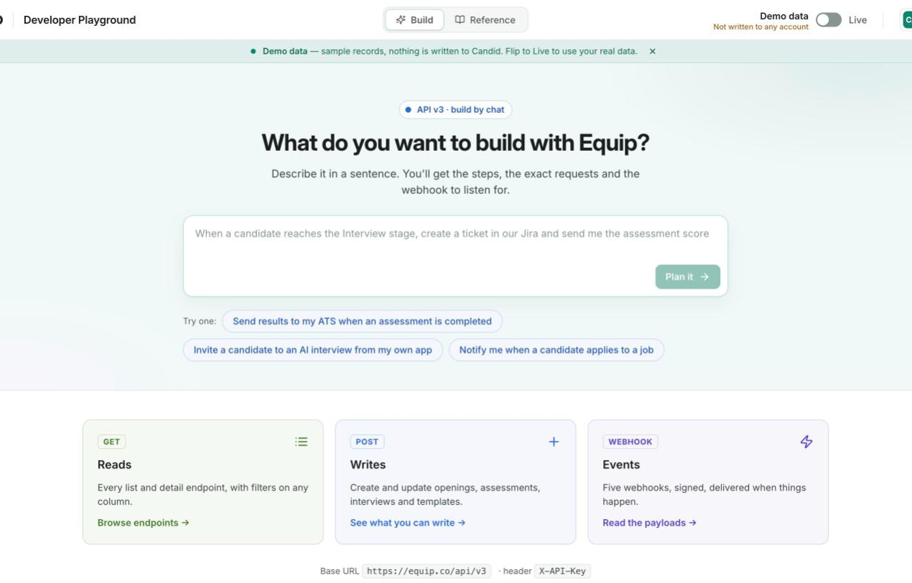

The **Developer Playground** at [equip.co/developers/](https://equip.co/developers/) is Equip's public API documentation with a try-it panel built in. Anyone can browse every endpoint and run read requests against demo data, no account needed. An organization Owner or Admin on a plan with API access can run the same reads on their own data without pasting a key.

{/* screenshot: the Developer Playground landing page on the Build tab with the prompt box and the Reads, Writes and Events cards */}

<Frame caption="The Developer Playground at equip.co/developers/">
  
</Frame>

## Try a Request

Every documented `GET` endpoint has a **try-it panel**. Pick the endpoint, set its query parameters, and run it.

<Steps>
  <Step title="Open the reference">
    Go to [equip.co/developers/reference/](https://equip.co/developers/reference/) and pick a resource, for example **Job openings**, then one of its operations.
  </Step>
  <Step title="Fill in the parameters">
    The panel lists the query parameters the operation accepts, including filters on any column. A run returns at most 25 records; set `limit` lower for a quicker look.
  </Step>
  <Step title="Run it">
    Click run. The response, its status and the request id are shown next to the request. In **Demo data** mode the request runs against a fictional organization, so nothing you do touches a real account.
  </Step>
  <Step title="Copy the code">
    Switch the snippet between **curl**, **Python** and **JavaScript** and copy it. The snippet carries a placeholder where your API key goes.
  </Step>
</Steps>

<Note>
The page runs reads only. For a `POST`, `PATCH` or `DELETE` operation the panel still shows the documentation and the code snippet, which you run from your own code with your [API key](/api-keys-and-authentication).
</Note>

## Run on Your Own Data

The **Demo data / Live** switch at the top of the page moves the try-it panel onto your organization's data. Live mode runs each request as your organization's admin sees it, without you pasting the API key anywhere.

| Requirement for Live mode | What you see otherwise |
|---|---|
| Signed in to Equip | A prompt to sign in |
| Organization **Owner or Admin** | A notice saying only an Owner or Admin can run requests on the organization's data, and who to ask |
| A plan with **API & Webhooks** (see [Compare Plans](/compare-plans)) | An upgrade prompt |

Live runs count against your organization's own [rate limit](/api-rate-limits-and-errors), and the panel shows the `RateLimit-*` headers each response carries, so you can see your remaining allowance as you work.

<Warning>
Live mode reads your real candidates, applications and results. The page never stores a credential, and every live run is attributed to your organization like any other API call.
</Warning>

## Browse the Reference

The **Reference** tab is generated from the same OpenAPI document that drives the API, so it never drifts from what the server accepts.

| Page | URL | What it covers |
|---|---|---|
| Reference | `https://equip.co/developers/reference/` | Every resource and operation, with request and response schemas and example responses |
| Guide | `https://equip.co/developers/reference/guide/` | The conventions every request follows, a worked request and the resource list |
| Webhooks | `https://equip.co/developers/reference/webhooks/` | Every webhook event and its payload |
| OpenAPI document | `https://equip.co/api/v3/openapi.json` | The machine-readable description, for code generators and API clients |
| llms.txt | `https://equip.co/developers/llms.txt` | The whole reference as one plain-text page for AI coding agents |

Each operation page has its own address, so you can link a teammate straight to the endpoint you are discussing.

<Tip>
Point your AI coding agent at `https://equip.co/developers/llms.txt` to give it the full endpoint list in one fetch. It links to the OpenAPI document for the field-level detail.
</Tip>

## Build an Integration by Chat

The **Build** tab at [equip.co/developers/](https://equip.co/developers/) is a conversation with Equip's assistant in build mode. Describe what you want in a sentence, such as "post to Slack when an assessment is graded", and it answers with a plan.

A plan contains three parts:

- **The webhook to subscribe to**, when an event fits the request
- **The requests to make, in order**, each runnable on demo data right there with the code to copy
- **The part you write on your side**, stated plainly

<Note>
The assistant plans against demo data whether or not you are signed in, and it says plainly when Equip has no event or endpoint for what you asked. Your thread is kept in the browser tab, so a reload keeps it; **New conversation** starts over.
</Note>

## Related Resources

- [API Keys and Authentication](/api-keys-and-authentication) - Get the key the copied snippets need
- [API Integrations](/api-integrations) - What the REST API lets you read and write
- [API Rate Limits and Errors](/api-rate-limits-and-errors) - What the rate-limit headers in Live mode mean
- [Webhooks](/webhooks) - Set up the events the Build tab recommends
