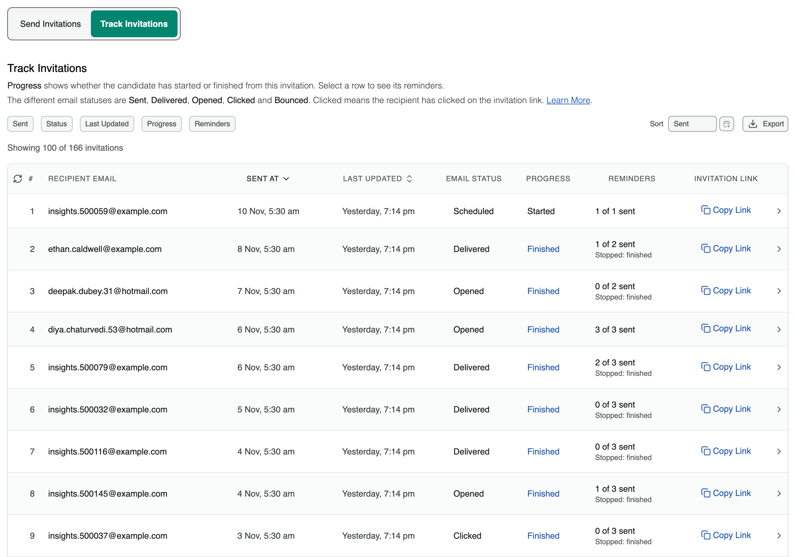
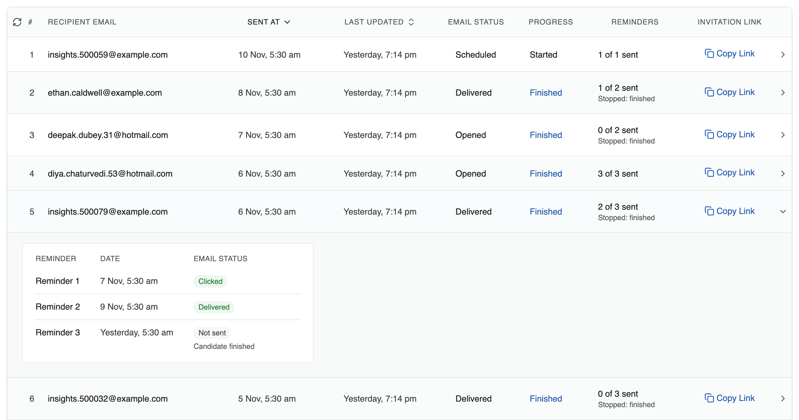

When you invite candidates by email, Equip tracks each invitation: whether it reached the candidate's inbox, whether they opened it, and whether they clicked the **assessment** or **AI interview** link.

<Note>
Status tracking is only available for **email invitations**. Candidates who join through a shared public URL are not tracked this way. See [Share URL vs Email Invitations](/share-url-vs-email) for the full comparison.
</Note>

## Tracking Statuses

<Steps>
  <Step title="Open the invite page">
    On the [Assessments dashboard](https://equip.co/recruiter/assessments/dashboard/) or [AI Interviews dashboard](https://equip.co/recruiter/ai-interviews/dashboard/), click **Invite** under the assessment or AI interview.
  </Step>
  <Step title="Switch to Track Invitations">
    Click the **Track Invitations** tab and check the **Email Status** column. Use **Copy Link** to get a candidate's invitation link.
  </Step>
</Steps>

{/* screenshot: Track Invitations tab showing the invitations table with the Email Status, Progress and Reminders columns */}

### Job Opening Stages

When an assessment or AI interview is a **stage of a job opening**, you invite candidates by [moving them to that stage](/changing-stages) in the Job Applications Dashboard. Those invitations are tracked on the stage's **Track Invitations** tab, and **Invite** opens that tab directly.

<Note>
Only assessment and AI interview invitations are tracked. Other pipeline emails, such as rejections, stage changes and offers, have no email status.
</Note>

<Frame caption="Track Invitations lists every invited candidate with the current status of their email">
  
</Frame>

## What Each Status Means

| Status | Meaning |
|---|---|
| **Scheduled** | The email is queued, or set to go out later, and has not been sent yet |
| **Sent** | The first status after the email is sent |
| **Bounced** | The email could not be delivered (invalid address, full inbox, and similar causes) |
| **Delivered** | The email successfully reached the candidate's inbox |
| **Opened** | The candidate opened the email |
| **Clicked** | The candidate clicked a link in the email |

These statuses are authoritative. If an email shows Delivered, Opened, or Clicked, that event actually happened, even if the candidate says otherwise.

<Note>
Some email clients, especially mobile apps, block open tracking. A candidate may have opened the email while the status still says **Delivered**.
</Note>

<Tip>
The default invitation template contains exactly one link, so **Clicked** means the candidate clicked the invitation link. If you add extra links while customizing the [email template](/email-invitations), Equip cannot tell which link was clicked.
</Tip>

## Progress and Reminders

Two more columns show what happened after the email.

| Column | Meaning |
|---|---|
| **Progress** | **Not started**, **Started** or **Finished**, for the attempt the candidate began from this invitation's link. **Finished** is a link to the candidate's report |
| **Reminders** | How many [reminders](/email-invitations#reminders) have gone out of those scheduled, such as **2 of 3 sent**, with the date of the next one or the reason they stopped. A dash means the invitation was sent without reminders |

Select a row to list its reminders. Each line shows the reminder's date and its **Email Status**, in the same words as the invitation's own: a reminder that went out shows how far its email got.

{/* screenshot: Track Invitations with one row expanded, listing three reminders with their dates and email statuses */}

<Frame caption="An expanded row lists each reminder with its date and how far its email got">
  
</Frame>

| Status | Meaning |
|---|---|
| **Scheduled** | The reminder will go out on its date if the candidate has not finished |
| **Sending** | The reminder has been handed to the mail service, which has not yet confirmed that it left. This normally lasts a few seconds |
| **Sent**, **Delivered**, **Opened**, **Clicked**, **Bounced** | The reminder went out, and this is how far its email got. See [What Each Status Means](#what-each-status-means) |
| **Not sent**, Candidate finished | The candidate finished before the reminder was due |
| **Not sent**, Link expired | The reminder fell on or after the link's expiry day |
| **Not sent**, Invitation was not delivered | The invitation, or an earlier reminder, bounced or was reported as spam |
| **Not sent**, A later reminder replaced it | Two reminders came due together, and only the later one was sent |
| **Not sent**, Sending failed | The email could not be sent after three attempts. Later reminders still go out |

Use the **Progress** and **Reminders** filters to find, for example, candidates who were reminded and still have not started. Both columns are included in the export.

<Note>
**Progress** follows this invitation's own link. A candidate who finished another way, for example through a second invitation, shows **Not started** here, and their reminders stop with **Not sent**, Candidate finished.
</Note>

## When Emails Bounce

A **Bounced** invitation never reached the candidate.

<Steps>
  <Step title="Re-invite with the correct address">
    Check the address for typos, then send a fresh invitation from the **Send Invitations** tab. For a job opening stage, re-invite the candidate from the job's applications on the [Job Openings dashboard](https://equip.co/recruiter/job-openings/dashboard/).
  </Step>
  <Step title="Reclaim the unused credit">
    The bounced invitation was never used, so you can [reclaim its credit](/reclaim-credits).
  </Step>
</Steps>

<Warning>
If the status says **Delivered** but the candidate cannot find the email, do not re-send immediately. Ask them to check their Spam folder and any other inboxes first; the email definitely reached their mail server. If it still cannot be found, re-invite them and reclaim the old credit.
</Warning>

## Related Resources

- [Email Invitations](/email-invitations) - How to send invitations, customize the email template and set reminders
- [Invitation Links](/invitation-links) - How unique links, expiry, and revoking work
- [Candidate Re-Attempts](/candidate-reattempts) - What to do when a candidate says they never got the invite
- [Reclaim Credits](/reclaim-credits) - Recover credits from unused invitations
