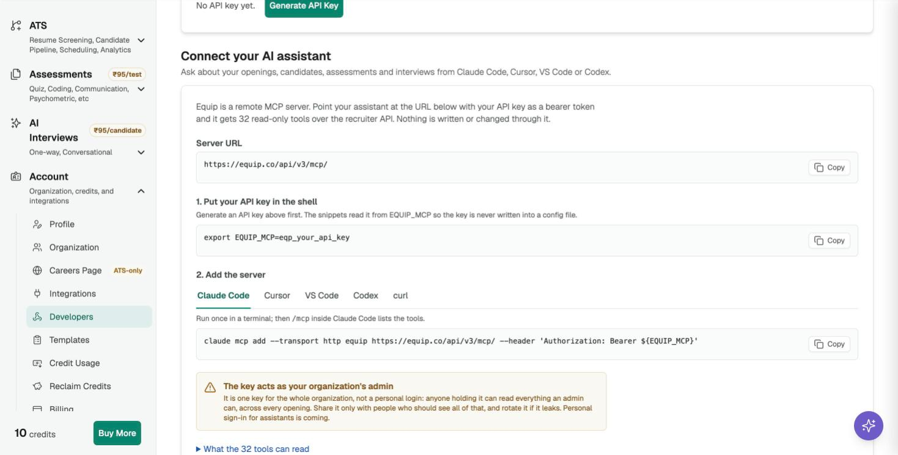

import { PlanGate } from "/snippets/plan-gate.mdx";

**Claude Code** connects to Equip's MCP server at `https://equip.co/api/v3/mcp/` with one command. The server is read-only, so Claude Code can look things up but never change them.

<PlanGate plan="Premium" annual />

## Add the Server

You need your organization's API key in your shell as `EQUIP_MCP` first; see [Connect Your AI Assistant to Equip](/connect-ai-assistant).

<Steps>
  <Step title="Run the add command">
    ```sh
    claude mcp add --transport http equip https://equip.co/api/v3/mcp/ --header 'Authorization: Bearer ${EQUIP_MCP}'
    ```

    Keep the single quotes. Claude Code stores the `${EQUIP_MCP}` reference and reads the key from your environment each time it starts, so the key is never written into its config.
  </Step>
  <Step title="Check the connection">
    Start Claude Code and run `/mcp`. **equip** shows as connected with its tools listed.
  </Step>
  <Step title="Ask a question">
    Try: "Which of my job openings have the most candidates waiting in screening?"
  </Step>
</Steps>

{/* screenshot: the Claude Code tab of Connect your AI assistant on Account → Developers */}

<Frame caption="The Claude Code snippet on the Developers page">
  
</Frame>

<Accordion title="Troubleshooting">
- **401 Invalid API key**: the key was mistyped or rotated, or `EQUIP_MCP` is not exported in the shell you started Claude Code from. Run `echo $EQUIP_MCP` there.
- **403 "isn't included in your plan"**: your plan does not include the MCP server. See [Compare Plans](/compare-plans), or [contact support](/contact-support) to have it switched on for your organization.
- **The server shows but has no tools**: quit and restart Claude Code after adding the server.
</Accordion>

## Related Resources

- [Connect Your AI Assistant to Equip](/connect-ai-assistant) - Getting the key, what the tools can read, other clients
- [API Integrations](/api-integrations) - The REST API behind the same key
