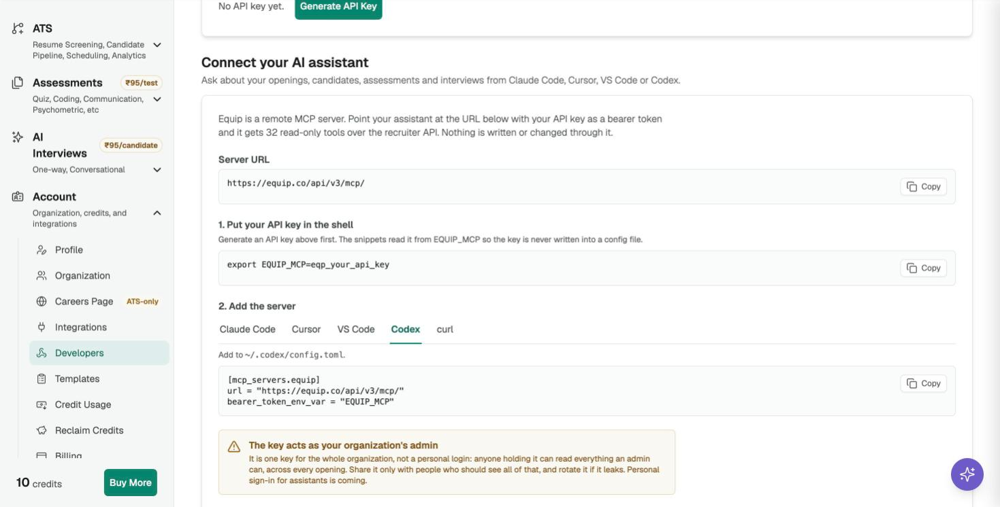

import { PlanGate } from "/snippets/plan-gate.mdx";

**Codex** connects to Equip's MCP server at `https://equip.co/api/v3/mcp/` through its config file. The server is read-only, so Codex can look things up but never change them.

<PlanGate plan="Premium" annual />

## Add the Server

You need your organization's API key in your shell as `EQUIP_MCP` first; see [Connect Your AI Assistant to Equip](/connect-ai-assistant).

<Steps>
  <Step title="Edit config.toml">
    Add this to `~/.codex/config.toml`:

    ```toml
    [mcp_servers.equip]
    url = "https://equip.co/api/v3/mcp/"
    bearer_token_env_var = "EQUIP_MCP"
    ```

    `bearer_token_env_var` names the variable, so Codex reads the key from your environment and the key itself never sits in the file.
  </Step>
  <Step title="Check the connection">
    Run `codex mcp list` in a terminal, or start Codex and ask "what tools do you have from equip?".
  </Step>
  <Step title="Ask a question">
    Try: "Which of my job openings have the most candidates waiting in screening?"
  </Step>
</Steps>

{/* screenshot: the Codex tab of Connect your AI assistant on Account → Developers */}

<Frame caption="The Codex snippet on the Developers page">
  
</Frame>

<Accordion title="Troubleshooting">
- **401 Invalid API key**: the key was mistyped or rotated, or `EQUIP_MCP` is not exported in the shell you started Codex from. Run `echo $EQUIP_MCP` there.
- **403 "isn't included in your plan"**: your plan does not include the MCP server. See [Compare Plans](/compare-plans), or [contact support](/contact-support) to have it switched on for your organization.
- **The server shows but has no tools**: quit and restart Codex after editing the file.
</Accordion>

## Related Resources

- [Connect Your AI Assistant to Equip](/connect-ai-assistant) - Getting the key, what the tools can read, other clients
- [API Integrations](/api-integrations) - The REST API behind the same key
