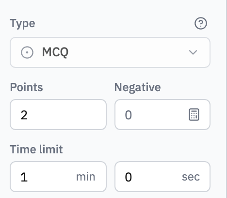

<Tip>
Only multiple-choice questions (MCQs) in Equip's own library quizzes carry negative points, and that cannot be turned off. Custom content never has negative marking unless you add it yourself.
</Tip>

## Equip Library Quizzes

**Negative points** apply in exactly one place: MCQs inside Equip-content quizzes. Other [test types](/test-types) and non-MCQ question types carry none.

Candidates see the negative points for each question on the question itself.

{/* screenshot: negative points shown on an Equip quiz MCQ during an attempt */}

You cannot disable negative marking on Equip's library quizzes. A small penalty makes candidates think twice before picking an option at random.

<Note>
Because of negative marking, scores on Equip-content quizzes can look lower than you expect. Use them for relative shortlisting rather than absolute judgments. See [What Is a Good Assessment Score?](/good-assessment-score) for guidance.
</Note>

## Custom Content

If you would rather test without negative marking, create your own questions with [Custom Tests](/custom-tests). Negative points are optional per question there, and you set the value.

<Steps>
  <Step title="Open Custom Tests">
    From the sidebar of the [Assessments Dashboard](https://equip.co/recruiter/assessments/dashboard/), click [**Custom Tests**](https://equip.co/recruiter/assessments/cms/home/) and create or edit a quiz.
  </Step>
  <Step title="Set points per question">
    Set negative points on each question, or skip them where you do not want deductions.
    {/* screenshot: custom quiz question editor showing points, timer, and negative points fields */}

    <Frame caption="Points, negative points and the timer on a question">
      
    </Frame>
  </Step>
  <Step title="Add the quiz to an assessment">
    In the assessment's Tests tab, add the quiz under **My Content**. An assessment can freely mix Equip content and custom tests.
  </Step>
</Steps>

<Tip>
Importing questions from Excel? The Import dialog's **Auto-calculate negative points** switch fills in deductions for MCQs automatically. See [Import Questions from Excel](/import-questions-from-excel).
</Tip>

## How Deductions Are Calculated

When negative points are assigned automatically, the formula is:

```
negative points = question points / number of options
```

For example, a 2-point MCQ with 4 options deducts **0.5 points** for a wrong answer. Equip's library quizzes use this calculation, and the Import dialog's auto-calculate switch applies the same formula to your custom MCQs.

<Note>
Multiple-answer questions (MCAs) are never auto-assigned negative points.
</Note>

A candidate's test score is the sum of points earned minus any deductions. See [Test Scores and Overall Score](/test-scores-and-overall-score) for how it feeds into the overall assessment score.

## Related Resources

- [Equip Content vs Custom Content](/equip-vs-custom-content) - Full comparison of what you can and cannot change per content type
- [Test Scores and Overall Score](/test-scores-and-overall-score) - How per-test points roll up into the overall score
- [Import Questions from Excel](/import-questions-from-excel) - Bulk-add custom questions with auto-calculated negative points
- [What Is a Good Assessment Score?](/good-assessment-score) - Interpreting scores that negative marking has pulled down
