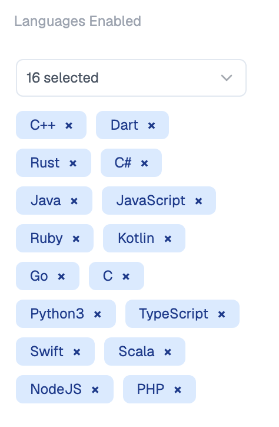

Equip's **Programming Tests** run in a browser-based code editor and are graded automatically.

## Supported Languages

Equip supports these languages out of the box and has ready-made **programming questions** for each. Every language runs on a fixed version.

| Language | Version |
|---|---|
| C | GCC 14.2, C11 (GNU dialect) |
| C++ | GCC 14.2, C++20 |
| C# | .NET 10 (LTS) |
| Dart | 3.12 |
| Go | 1.26 |
| Java | OpenJDK 21 (LTS, Amazon Corretto) |
| JavaScript | Node.js 22 (LTS) |
| Kotlin | 2.2, on OpenJDK 21 |
| NodeJS | Node.js 22 (LTS) |
| PHP | 8.3 |
| Python | 3.12 |
| Python (AI/ML) | 3.12, with NumPy, pandas, scikit-learn and SciPy |
| Ruby | 3.4 |
| Rust | 1.97 |
| Scala | 3.3 (LTS) |
| Swift | 6.3 |
| SQL | SQLite 3.40 |
| TypeScript | 5.9, on Node.js 22 |

<Note>
Equip also offers dedicated **SQL** and **CSS** coding challenges. See [Test Types](/test-types) for the full list.
</Note>

## The Coding Environment

{/* screenshot: candidate view of the in-browser coding editor with language selector */}

- Each Programming Test contains **one question**. To test more, add multiple programming tests to the assessment, or [randomize coding questions](/randomize-coding-questions).
- You choose which languages are **enabled** for each test. Candidates pick any enabled language.
- Equip's coding questions come in three [difficulty levels](/question-difficulty-levels).
- Unlike Equip's quizzes, you can select the exact coding question during setup and see it later in candidate results.

<Frame caption="The languages enabled for a programming test in the assessment builder">
  
</Frame>

<Warning>
Programming, SQL, and CSS tests are **desktop only**. Candidates on phones or tablets must switch to a computer.
</Warning>

A [custom programming test](/custom-programming-test) also lets you set the boilerplate code and test cases.

## Requesting Additional Languages

If the language you need is not in the table above, Equip can enable more languages for your account on request.

<Steps>
  <Step title="Create your Equip account">
    Additional languages are enabled per account, so [sign up](https://equip.co) first if you have not already.
  </Step>
  <Step title="Reach out on live chat">
    Open the chat widget in your Recruiter Dashboard and tell us which language you need, or email hello@equip.co. Once enabled, the language appears in the language options of your programming tests.
  </Step>
</Steps>

<Tip>
Need a whole test or skill, not just a language? See [Can't Find Your Role or Skill?](/cant-find-role-or-skill).
</Tip>

## Related Resources

- [Test Types](/test-types) - Every test type you can add to an assessment, including SQL and CSS challenges
- [Custom Programming Test](/custom-programming-test) - Build your own coding question with boilerplates and test cases
- [Randomize Coding Questions](/randomize-coding-questions) - Show each candidate a different question from a pool
- [Can't Find Your Role or Skill?](/cant-find-role-or-skill) - How to request new tests or skills from Equip
