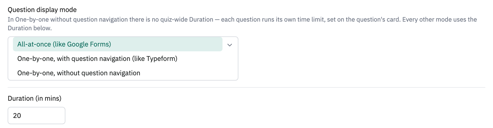
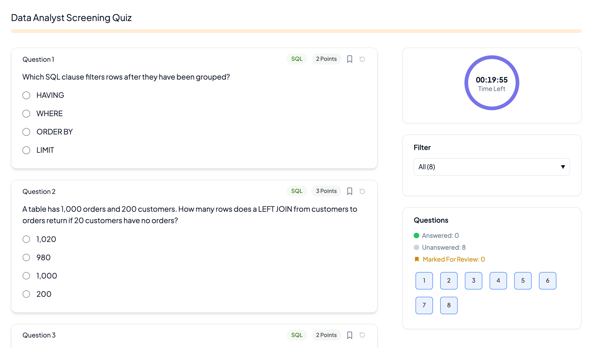
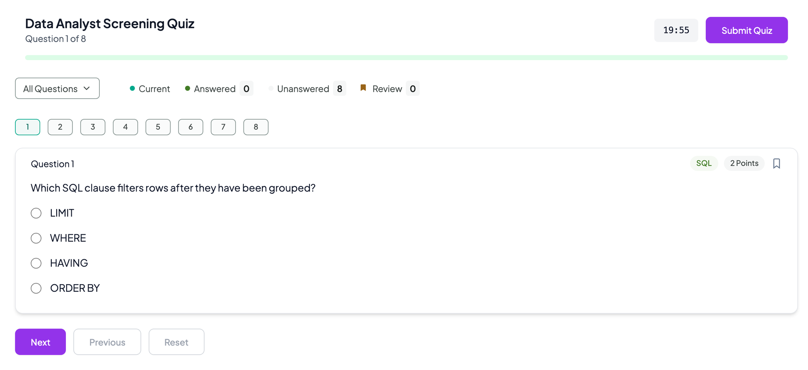
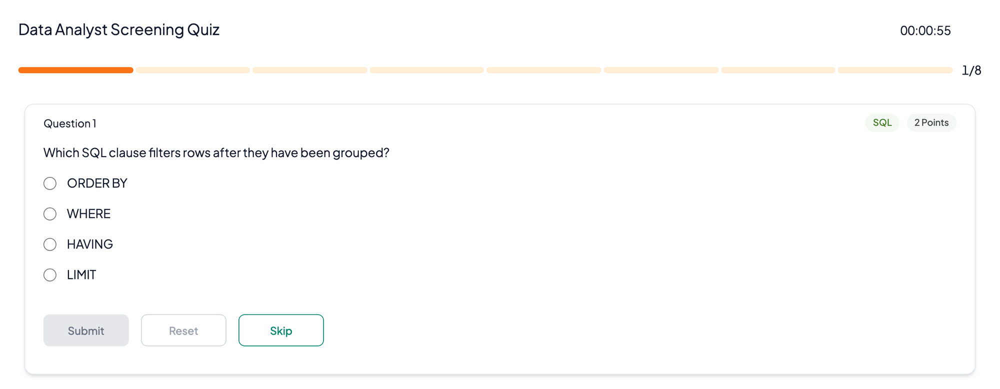

<Tip>
A custom quiz can show every question on one page (**all at once**), or one question at a time (**one by one**), either with navigation between questions or without it. Pick the mode under **Question display mode** in the quiz's settings.
</Tip>

## Choose a Display Mode

You set the display mode for each custom quiz you build in [Custom Tests](https://equip.co/recruiter/assessments/cms/home/).

<Steps>
  <Step title="Open the quiz settings">
    From the [Assessments Dashboard](https://equip.co/recruiter/assessments/dashboard/), open [**Custom Tests**](https://equip.co/recruiter/assessments/cms/home/), find your quiz and click **Settings**.
  </Step>
  <Step title="Pick a Question display mode">
    Under **General**, choose one of the three modes from **Question display mode**.
  </Step>
  <Step title="Set the time limit and save">
    For all at once and one by one with navigation, enter a **Duration** for the whole quiz. For one by one without navigation, set a time limit on each question's card instead. Then click **Save**.
  </Step>
</Steps>

{/* screenshot: Question display mode setting in the custom quiz settings */}

<Frame caption="The Question display mode setting">
  
</Frame>

<Note>
The new mode applies to candidates who start the quiz after you save.
</Note>

## The Three Modes

| | All at once | One by one, with navigation | One by one, without navigation |
|---|---|---|---|
| **Questions shown** | Every question on one page | One at a time | One at a time |
| **Going back** | Yes, until submitting | Yes, with **Previous** or the question numbers | No, answered and skipped questions are gone |
| **Timer** | One **Duration** for the whole quiz | One **Duration** for the whole quiz | A time limit on each question |
| **Review tools** | Bookmarks, status filter, question map | Bookmarks, status filter, numbered question buttons | Progress bar |
| **Like** | Google Forms | Typeform | A timed exam |

### All at once

Every question in the quiz sits on one page. Beside them, the candidate sees the time left, a **Filter** for answered, unanswered and bookmarked questions, and a map of question numbers to jump to any question.

{/* screenshot: candidate view of an all-at-once quiz */}

<Frame caption="An all-at-once quiz, every question on one page">
  
</Frame>

### One by one, with navigation

The candidate sees one question at a time, with **Next** and **Previous** buttons and a row of question numbers to jump between questions. Status counts show how many questions are answered, unanswered and marked for **Review**, and one timer runs for the whole quiz.

{/* screenshot: candidate view of a one-by-one quiz with navigation */}

<Frame caption="One by one, with question navigation">
  
</Frame>

### One by one, without navigation

The candidate sees one question at a time with a progress bar and a countdown for that question. They answer with **Submit** or move on with **Skip**, and cannot go back.

{/* screenshot: candidate view of a one-by-one quiz without navigation */}

<Frame caption="One by one, without question navigation">
  
</Frame>

<Warning>
Skipping is final in this mode. Once a candidate clicks **Skip**, that question cannot be revisited, even if time remains.
</Warning>

## Picking the Right Mode

**One by one, without navigation** is the strictest choice for hiring. Each question has its own short time limit, and the next question is only sent to the candidate after the current one is answered, so the full quiz is never on screen to look up or share.

**One by one, with navigation** keeps the focus of one question per screen while letting candidates manage their own time and return to questions they bookmarked.

**All at once** suits quizzes where candidates should see the whole test, choose their own order and review every answer before submitting.

<Note>
Some tests always use a fixed mode. Quizzes from Equip's question library always show one question at a time. Programming, SQL and CSS tests show one question at a time with navigation, and video interview tests show one question at a time without navigation.
</Note>

## Related Resources

- [Custom Quiz Time Limits](/custom-quiz-time-limits) - How timers work in each display mode
- [Custom Tests](/custom-tests) - Create quizzes with your own questions
- [Time Limits](/time-limits) - Where timers can be set for each test type
- [Same or Random Questions](/same-or-random-questions) - How Equip randomizes quiz questions per candidate
