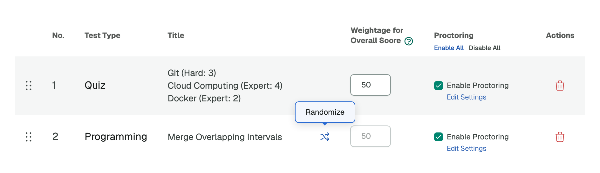
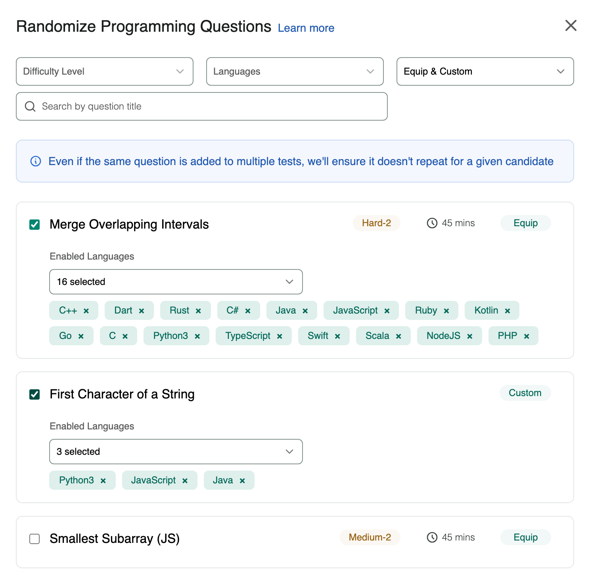

By default, a coding test on Equip has one **fixed question** that every candidate solves. If you are worried that candidates might share it, use **Randomize** to turn that single question into a pool of variants, and each candidate receives one at random.

## How to Randomize

<Steps>
  <Step title="Open the assessment's settings">
    From the Recruiter Dashboard, open **Settings** for the assessment and switch to the **Test Order** tab.
  </Step>
  <Step title="Click the Randomize icon">
    Click the **Randomize** icon on the coding test.
    {/* screenshot: Test Order tab with the Randomize icon highlighted on a coding test */}

    <Frame caption="The Randomize icon on a Programming test">
      
    </Frame>
  </Step>
  <Step title="Select the questions">
    Pick the questions for the pool, then save.
    {/* screenshot: question selection list for randomizing a coding test */}

    <Frame caption="Choosing the questions to randomize between">
      
    </Frame>
  </Step>
</Steps>

<Warning>
For Programming tests, every question in the pool must keep at least one **enabled programming language**. The builder blocks you from saving a variant with no languages enabled.
</Warning>

<Note>
A **Programming** or **SQL** test contains exactly one question. To test more coding skills, add another coding test to the same assessment.
</Note>

## How Variants Are Assigned

When a candidate starts the test, Equip picks **one question at random** from the pool. You cannot choose which candidate gets which variant, and candidates never see the other questions in the pool.

Coding test results show **which question the candidate attempted**.

<Tip>
Keep the questions in a pool at a **similar difficulty level** so scores stay comparable across candidates.
</Tip>

## Related Resources

- [Do Candidates See the Same or Random Questions?](/same-or-random-questions) - How randomization works across every test type
- [Creating a Custom Programming Test](/custom-programming-test) - Build your own coding questions to include in a pool
- [Supported Programming Languages](/programming-languages) - Languages and versions available in coding tests
- [Creating an Assessment](/create-assessment) - The full builder walkthrough, including the Test Order tab
