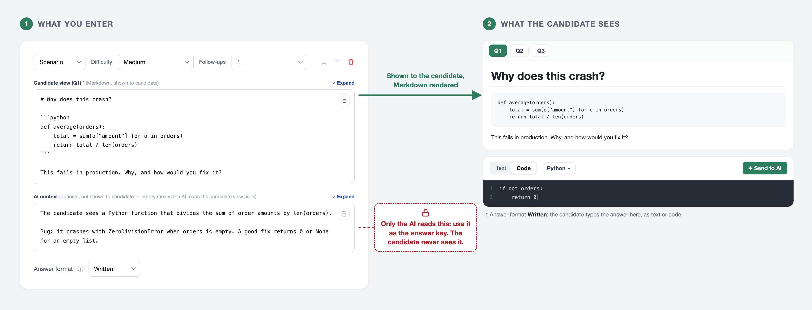
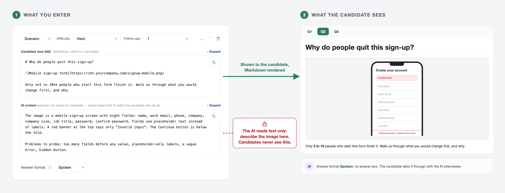
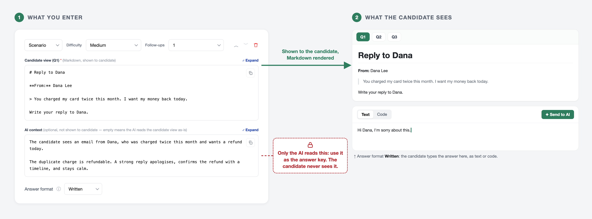
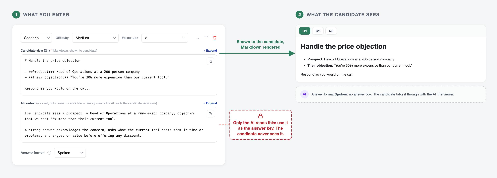

A **Scenario** puts reference material in front of the candidate during a conversational interview. The candidate sees it in a panel on screen while the AI asks them about it, so you can test how someone works with real material, not just how they talk about it.

Scenarios suit technical and non-technical roles alike. A developer can debug a code snippet, a designer can critique a screen, a support hire can reply to an upset customer, and a salesperson can handle a prospect's objection.

<Note>
Scenarios are rolling out gradually and may not yet appear in your Add item menu.
</Note>

## Example Scenarios by Role

Here is what a Scenario looks like for four different roles. In each image, the left side is what you enter and the right side is what the candidate sees.

| Role | What the candidate sees | Markdown used | Answer format |
|---|---|---|---|
| **1. Software developer** | A short function with a bug | Code block | Written |
| **2. Product designer** | A screen design to critique | Image | Spoken |
| **3. Customer support** | An upset customer's email | Quote | Written |
| **4. Sales** | A prospect's price objection | List | Spoken |

### 1. Software Developer

Paste a short snippet with a bug in it and ask the candidate to find and fix it. The AI context tells the AI what the bug is, so it can probe and grade against it.

<Frame caption="Software developer: a Python function that crashes on an empty list">
  
</Frame>

### 2. Product Designer

Show a screen design as an image and ask what the candidate would change. The AI cannot see images, so the AI context describes what the screen shows and which problems to look for.

<Frame caption="Product designer: a mobile sign-up form most people abandon">
  
</Frame>

### 3. Customer Support

Quote a short customer email and ask the candidate to write a reply. The AI context sets out the right outcome and what a strong reply sounds like.

<Frame caption="Customer support: an email about a double charge">
  
</Frame>

### 4. Sales

Describe a prospect and their objection, then ask the candidate to respond as they would on a call. With a **Spoken** answer, you hear how they handle pushback in real time.

<Frame caption="Sales: a prospect says the product costs too much">
  
</Frame>

## Adding a Scenario

<Steps>
  <Step title="Open the interview's settings">
    From the [AI Interviews dashboard](https://equip.co/recruiter/ai-interviews/dashboard/), open your conversational interview and go to the **Topics & questions** section.
  </Step>
  <Step title="Add a Scenario item">
    Click **Add item** and choose **Scenario**.
  </Step>
  <Step title="Write the candidate view">
    Enter the material the candidate should see, in Markdown. Start with a heading, add the material, and end with the question you want answered.
  </Step>
  <Step title="Add AI context (optional)">
    Describe anything the AI cannot read from the candidate view, such as an image, and the points a strong answer should cover.
  </Step>
  <Step title="Set difficulty, follow-ups and answer format">
    Pick a **Difficulty**, the number of **Follow-ups** (0 to 5), and an **Answer format** if the Workspace is on.
  </Step>
</Steps>

During the interview, each Scenario appears as a numbered tab (Q1, Q2 and so on) above the candidate's answer area. The AI switches tabs as the conversation moves on.

## What You Can Put in the Candidate View

The candidate view is written in **Markdown**, a simple way to format text with symbols. These elements are supported:

| Element | How to write it | Use it for |
|---|---|---|
| **Heading** | `# Review this function` | The scenario's title |
| **Bold** and *italic* | `**bold**`, `*italic*` | Key facts the candidate must not miss |
| **List** | `- item` or `1. item` | Requirements, constraints, order details |
| **Quote** | `> text` | Customer emails, messages, feedback |
| **Table** | `\| Option \| Cost \|` rows | Options to compare, data, account details |
| **Code block** | Code between two lines of three backticks | Code to review, logs, queries |
| **Image** | `` | Screen designs, charts, diagrams |

The candidate view and AI context can each hold up to **50,000 characters**.

<Warning>
Images are added by URL only; you cannot upload them. Host the image somewhere the candidate's browser can open it without signing in, or it will not appear.
</Warning>

## Writing AI Context

When you fill in **AI context**, the AI reads it instead of the candidate view. The AI also uses it when it evaluates the candidate's answer. The candidate never sees it.

| Use AI context to | Example |
|---|---|
| Describe an image | *The image is a sign-up form with eight fields and a vague error message.* |
| Set out what a strong answer covers | *Bug: it crashes when the list is empty. A good fix returns 0.* |
| Share facts the candidate should work out | *The duplicate charge is refundable.* |

<Warning>
Because the AI reads AI context in place of the candidate view, include a short summary of what the candidate sees. Otherwise the AI will not know what is on the candidate's screen.
</Warning>

## Choosing an Answer Format

The **Answer format** decides how the candidate responds. It appears only when the [Workspace](/interview-workspace) is turned on for the interview.

| Answer format | What the candidate does | Best for |
|---|---|---|
| **Spoken** | Talks it through with the AI; no answer box | Design critiques, case discussions |
| **Written** | Types the answer in the Workspace, as text or code | Code fixes, email replies |
| **Either** | Chooses whether to speak or write | Mixed tasks where both work |

## Related Resources

- [Questions, Topics, and Scenarios](/interview-content-types) - How Scenarios compare with Questions and Topics
- [The Workspace: Code and Written Answers](/interview-workspace) - Turn on written and code answers
- [Creating a Conversational AI Interview](/create-conversational-interview) - Set up the interview your Scenarios go into
- [AI Interview Reports](/interview-reports) - See how candidates answered each Scenario
