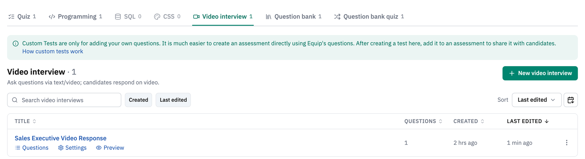
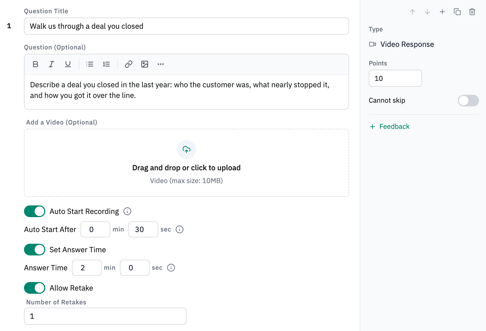
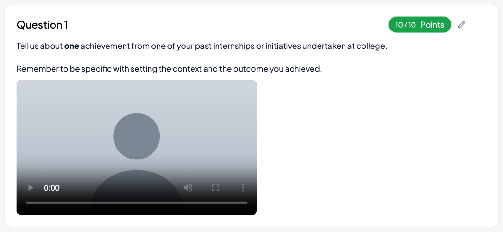

In a **Video Response** test, candidates record video answers to your questions, and you watch the recordings later and award points. It is a quick way to assess communication skills and understand how a candidate thinks through a problem.

Recording happens inside Equip and the attempt is proctored, so you do not have to worry about scripted or edited answers.

<Note>
Video Response tests work on mobile devices as well as desktops.
</Note>

## Creating a Video Response Test

A Video Response test is created as a **Custom Test** first, then added to any assessment.

<Steps>
  <Step title="Open Custom Tests">
    Go to [**Custom Tests**](https://equip.co/recruiter/assessments/cms/home/).
  </Step>
  <Step title="Create the test">
    Select the **Video interview** tab, click **New video interview**, and click the pencil next to the title to rename it.
  </Step>
  <Step title="Add questions">
    Fill in the first question, then click **Add question** for more. A Video Response test can hold up to **4 question screens**.
  </Step>
  <Step title="Save and add to an assessment">
    Save the test, then add it to a new or existing assessment by choosing **My Content** when adding a test.
  </Step>
</Steps>

{/* screenshot: Video interview tab of Custom Tests with the New video interview button */}

<Frame caption="The Video interview tab of Custom Tests">
  
</Frame>

<Note>
Like any other test, a Video Response test costs 1 credit per candidate who attempts it.
</Note>

## Recording Settings

Each question has its own fields and settings:

| Field or setting | What It Does |
|---|---|
| **Question Title** | The question candidates answer. |
| **Question (Optional)** | Extra detail or instructions, with text formatting. |
| **Add a Video (Optional)** | A video prompt candidates watch before answering, up to 10 MB. |
| **Auto Start Recording** | Starts the recording after the time you set in **Auto Start After**, so candidates cannot rehearse indefinitely. |
| **Set Answer Time** | Limits how long the recorded response can be, in **Answer Time**. |
| **Allow Retake** | Lets candidates re-record their answer, up to the **Number of Retakes** you set. |
| **Points** | The maximum points for the question, in the side panel. |
| **Cannot skip** | Makes the question mandatory, in the side panel. |

{/* screenshot: video response question with Points, Auto Start Recording, Set Answer Time, Allow Retake and Cannot skip */}

<Frame caption="A video response question and its settings">
  
</Frame>

<Tip>
Combine **Auto Start Recording** with **Set Answer Time** to give the candidate a fixed amount of thinking time, then a fixed amount of speaking time.
</Tip>

## Retakes and Duration Limits

Retakes and time limits are both set at the **question level**, through **Allow Retake** and **Set Answer Time**. There is no whole-test timer and no assessment-level time limit on Equip.

<Note>
If you leave **Set Answer Time** off, that question does not restrict how long the recording can be.
</Note>

## Grading Video Responses

Video Response tests are **graded manually**. Until you grade every response, the test and the candidate's overall score stay marked as ungraded.

<Steps>
  <Step title="Open the candidate's results">
    From the assessment results page, click the candidate's Video Response test score.
  </Step>
  <Step title="Watch and award points">
    Play each recording, then click the pencil icon to award points. You can filter questions by grading status.
  </Step>
</Steps>

{/* screenshot: video response grading view with the Not Yet Graded outline and pencil icon */}

<Frame caption="A graded video response, with the pencil icon to change its points">
  
</Frame>

<Warning>
Ungraded submissions are easy to miss. Use the **Show Ungraded** filter on the results page to list them.
</Warning>

For the full grading flow, including editing scores later, see [Manual Grading](/manual-grading).

## Related Resources

- [Custom Tests](/custom-tests) - How custom tests work and how to add them to assessments
- [Manual Grading](/manual-grading) - Watch responses and award points step by step
- [Test Types](/test-types) - All test types you can combine with a Video Response test
- [Question Limits](/question-limits) - Maximum questions allowed per test type
